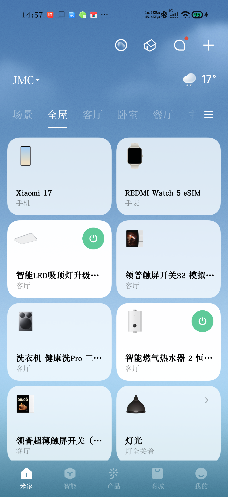
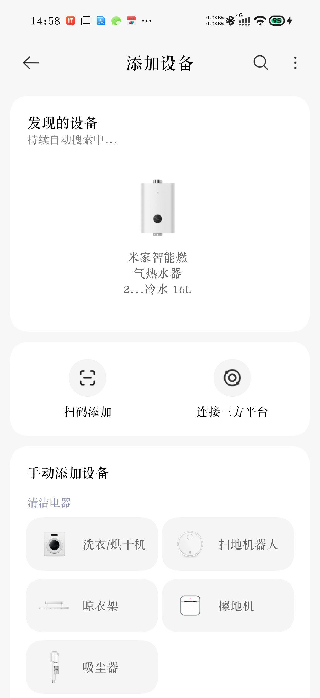
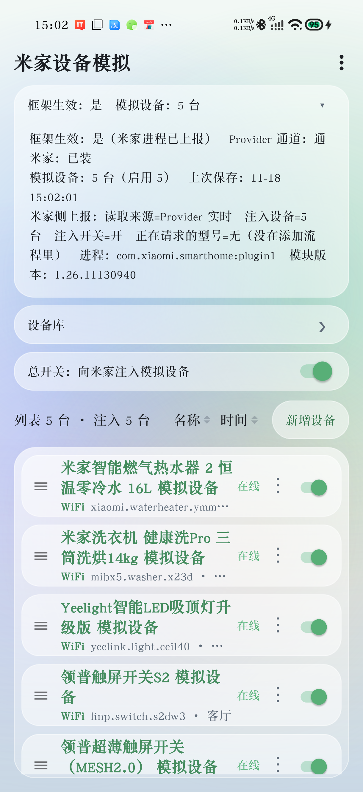
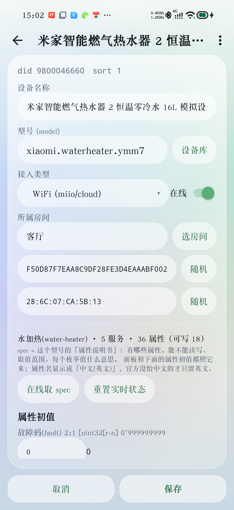
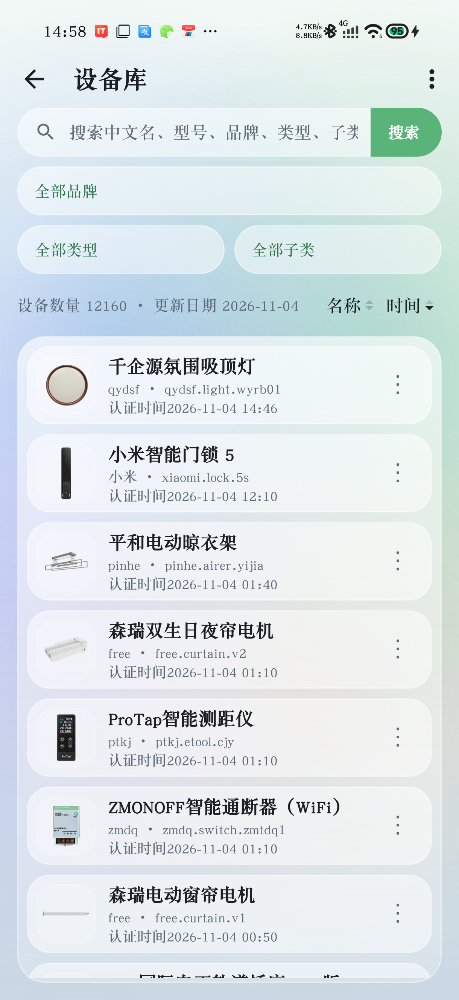
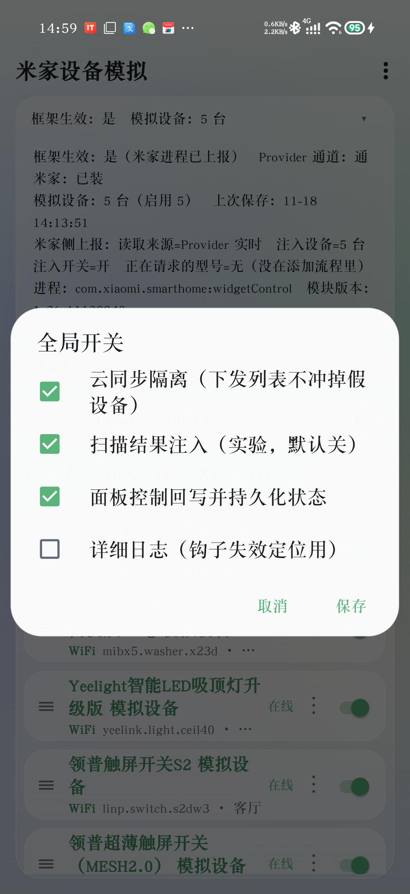
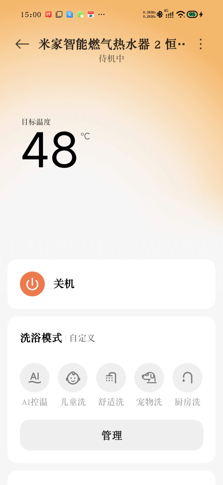
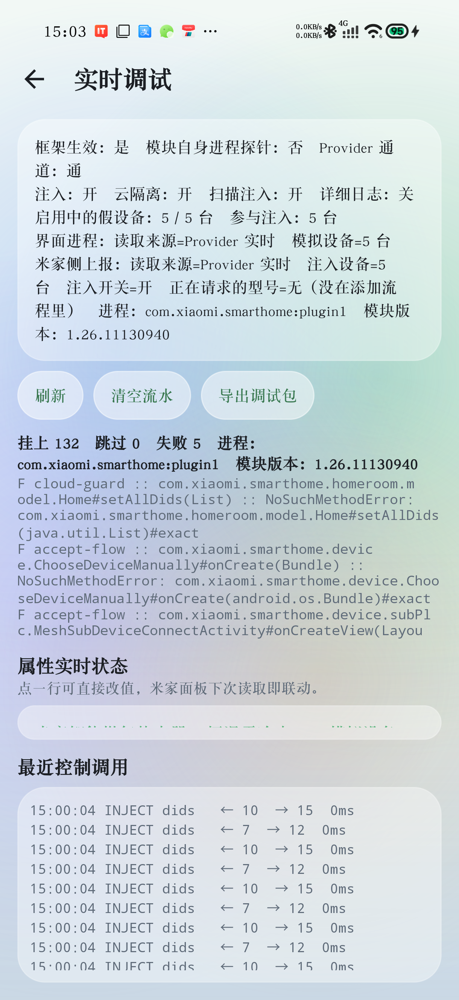

<!--
  Author: Ctrl-Ling
  Last Modified By: Ctrl-Ling
  Last Modified At: 2026-11-18 15:04:05 +08:00
-->

# 米家设备模拟 / MIJIA Device Simulator

一个 LSPosed 模块：把**任意米家认证型号**做成"假设备"塞进米家 App，让它在首页、房间、详情页、自动化、添加流程里表现成一台真设备——而且这台设备的一切读数、开关、动作都由本地状态机应答，不联网、不改账号、不碰 token 校验。

实测环境：小米手机（HyperOS / Android 16）+ 米家 **11.9.705**。钩子全部按"形状指纹"定位而不是写死混淆类名，米家小版本升级大概率仍然有效。

| 米家首页里的模拟设备 | 添加设备页"发现的设备" | 模块主界面 |
|---|---|---|
|  |  |  |
| 热水器 / 洗衣机 / 吸顶灯 / 触屏开关都进"客厅" | 扫描结果注入打开后，原生卡片直接出现 | 状态块 + 总开关 + 设备列表 |

| 编辑模拟设备 | 设备库（12,160 条） | 全局开关 |
|---|---|---|
|  |  |  |
| 型号、接入类型、房间、token/MAC、spec、属性初值 | 中文名/型号/品牌/类型/子类搜索 + 排序 | 云同步隔离 / 扫描结果注入 / 面板回写 / 详细日志 |

| 热水器详情页（可控制） | 实时调试 |
|---|---|
|  |  |
| 开关双向可控，"待机中 48℃"来自本地状态机 | 钩子命中/失败原因、属性实时改值、控制调用流水 |

## 能做什么

**1. 把任意型号做成米家设备**

- 内置米家认证设备库 **12,160 条**（中文名、品牌、型号、类型、子类、认证时间、设备图），支持边打边搜、分类/子类/品牌筛选、按名称或时间三态排序。
- 填的是一台"真设备"的字段：did、型号、名称、房间、接入类型（WiFi / 蓝牙 BLE / 蓝牙 Mesh 子设备 / Zigbee 子设备 / 网关本体）、在线状态、token、MAC。
- 型号的 spec（属性说明书）可在线拉取，也可用打包在 APK 里的本地副本；属性初值按 spec 自动生成编辑器（开关、数值范围、枚举）。

**2. 在米家里"像真的"**

- **首页列表**：模拟设备出现在"全屋"和它所属房间，带真实设备图；卡片开关能直接开/关。
- **详情页 / 控制面板**：在插件 Host API 层直接应答 `getPropertyValues` / `setPropertyValue` / `doAction`，所以读数、开关、动作都不报"数据获取异常"。
- **RN 插件详情页**：热水器这类 `:plugin0` 里跑的 React Native 页面，走 `callSmartHomeAPI`（`batchdevicedatas` / `prop.get` / `prop.set` / `action` / `getsettingv2`）本地应答，加载中→待机中、目标温度、开关都正常。
- **自动化**：创建自动化时能选到模拟设备；触发条件页、执行动作页按设备**自身 spec** 生成可选项，不是套模板；"不在当前家庭"黄条/灰行/保存失败已放行。

**3. 走米家自己的添加流程**

- **「添加设备」页的"发现的设备"**：用米家自己的 `PushBindEntity` 造原生卡片，点进去就是正常的配网向导。
- **Wi-Fi 扫描页**（手动添加 → 设备重置 → 扫描中）：注入合成扫描结果，SSID 伪装成 `型号点号换横杠_miap_MAC末4`。
- **蓝牙扫描页**：注入合成 BLE 广播条目（型号 + MAC），和真设备摆在一起。

**4. 不破坏真实设备**

- **云同步隔离**：米家下发的设备列表不会把假设备冲掉，也不会把假 did 上报成家庭成员（假 did 走保留段并打 `mijiaSimulated` 标记）。
- 任何钩子失效只降级：失败的那一组在"实时调试"里标红，真实设备不受影响。

**5. 可观测**

- **实时调试页**：挂上/跳过/失败统计 + 失败原因、每台设备每个属性的实时值（点一行直接改值）、最近控制调用流水（INJECT / GET / SET / ACTION，入参出参耗时）。
- 导出调试包、清空流水、临时开详细日志。

## 怎么用

### 一、安装与首次配置

1. 安装 `米家设备模拟-*.apk`（debug 或 release 均可）。
2. 打开 **LSPosed → 模块 → 启用「米家设备模拟」**。
3. 作用域勾 **两个**：`米家`、`米家设备模拟`（第二个用于给自己挂探针，判断框架是否真的生效）。
4. 完全退出米家（最近任务划掉），再打开米家。
5. 打开模块图标，顶部状态块应显示：**框架生效 = 是、Provider 通道 = 通、米家 = 已装**。

> 冷启动米家后如果整场空白：MIUI 自启动管控会拦住米家拉起模块进程。先打开一次模块界面（会广播一次配置变更），或到安全中心给本模块放开自启动。

### 二、加一台模拟设备

1. 首页点 **新增设备**。
2. **型号**一栏点 **设备库** 挑一个（也可以直接手输型号）。
3. 选 **接入类型**；子设备（Mesh / Zigbee）需要选父网关。
4. 填 **所属房间**；token / MAC 可点「随机」。
5. spec 没加载时点 **在线取 spec**；下方"属性初值"按 spec 逐项填。
6. 回首页确认 **总开关：向米家注入模拟设备** 是开的，然后点 **保存**。
7. 回米家（下拉刷新或退出重进）就能看到这台设备。

首页每行右侧：拖拽条 `≡` 调顺序、开关单独停用、行尾 `⋮` 低频操作；同名排序按钮点一下正序、两下倒序、三下还原。

### 三、在米家里控制

- 点卡片进详情页，开关/滑条/动作都走本地状态机；值会持久化，杀掉米家再进来还是那个值。
- 想快速验证联动：模块 → ⋮ → **实时调试 → 属性实时状态**，点一行改值，米家面板下次读取就跟着变。

### 四、让设备出现在添加流程里

1. 模块 → ⋮ → **更多开关** → 勾选 **扫描结果注入（实验，默认关）** → 保存。
2. 米家 → 右上角 ＋ → **添加设备**：
   - 页面上方 **"发现的设备 / 持续自动搜索中…"** 会出现模拟设备卡片；
   - 或者走手动添加：选品类 → 型号 → **设备已重置** → 扫描页出现同名卡片，点进去完成向导。
3. 关掉这个开关，已注入的卡片会被撤回。

### 五、四个全局开关

| 开关 | 作用 |
|---|---|
| 云同步隔离 | 米家下发列表不冲掉假设备（**建议常开**） |
| 扫描结果注入 | 添加设备 / Wi-Fi 扫描页 / 蓝牙扫描页出现模拟设备（默认关） |
| 面板控制回写并持久化状态 | 详情页操作写入状态机并落盘，重启米家后保持 |
| 详细日志 | 钩子失效时打开，便于定位类名变化 |

开关保存后不需要重启米家：配置走 Provider + `notifyChange`，米家四个进程会各自热重载。

### 六、出问题看哪里

1. 模块 → ⋮ → **实时调试**：
   - **挂上 / 跳过 / 失败**：全是空 = 米家进程没加载模块（检查作用域并真正重启米家）；`F` 行会写清是哪个类、哪个方法、什么异常。
   - **属性实时状态**：确认状态机里的值是不是你要的。
   - **最近控制调用**：有记录 = 米家走到了我们的控制层；没记录通常是那个子进程没被注入。
2. 米家侧上报那一行会写清：读取来源（Provider / 镜像 / 兜底文件）、注入设备数、注入开关、正在请求的型号、上报进程。
3. 常用命令（adb）：

```bash
# 米家侧当前读到了什么
adb shell content call --uri content://com.mijia.devicesim.provider/config --method getReport

# 模块自己保留的诊断文件
adb shell run-as com.mijia.devicesim cat files/report.json
adb shell run-as com.mijia.devicesim cat files/calllog.json
```

## 已知边界

- **米家版本**：11.9.705 实测通过；钩子按形状定位，新版本改名后"实时调试"会标出失败组，按 `docs/HOOKS.md` 补候选即可。
- **洗衣机 RN 详情页**仍是白屏：它的 UI 布局来自云端 DSL，本地没有这份 layout；其余热水器/灯/开关类 RN 面板已本地应答。
- **扫描结果注入默认关**：它依赖米家的扫描调度被真正触发；"添加设备"首页那一栏米家自己只渲染第一条（注入的多条在向导页会精确显示当前型号）。
- 不联网伪造云端绑定、不改账号、不碰 token 校验：全部依赖米家本地的列表读取与控制入口。

## 目录

- [`docs/USAGE.md`](docs/USAGE.md) — 更细的使用说明与配置格式
- [`docs/HOOKS.md`](docs/HOOKS.md) — 钩子点清单与形状指纹
- 构建：Android Studio / `./gradlew assembleDebug`（JDK 17，Gradle 8.8）
